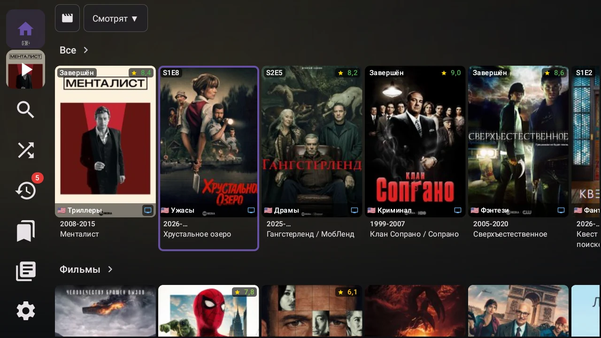
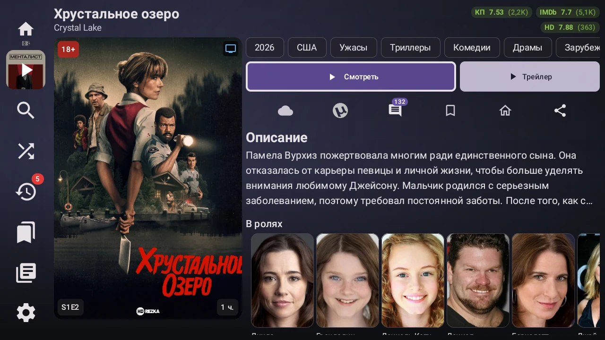
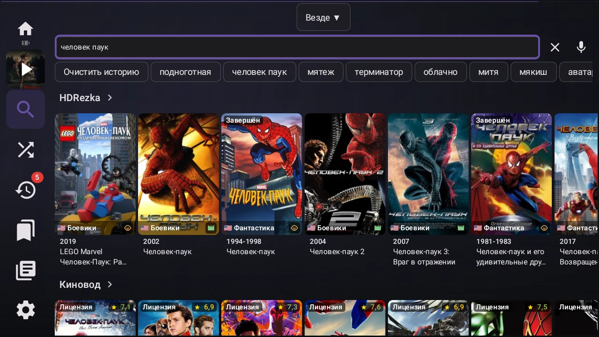
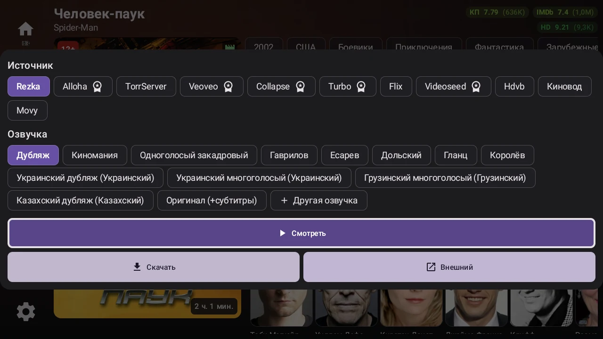
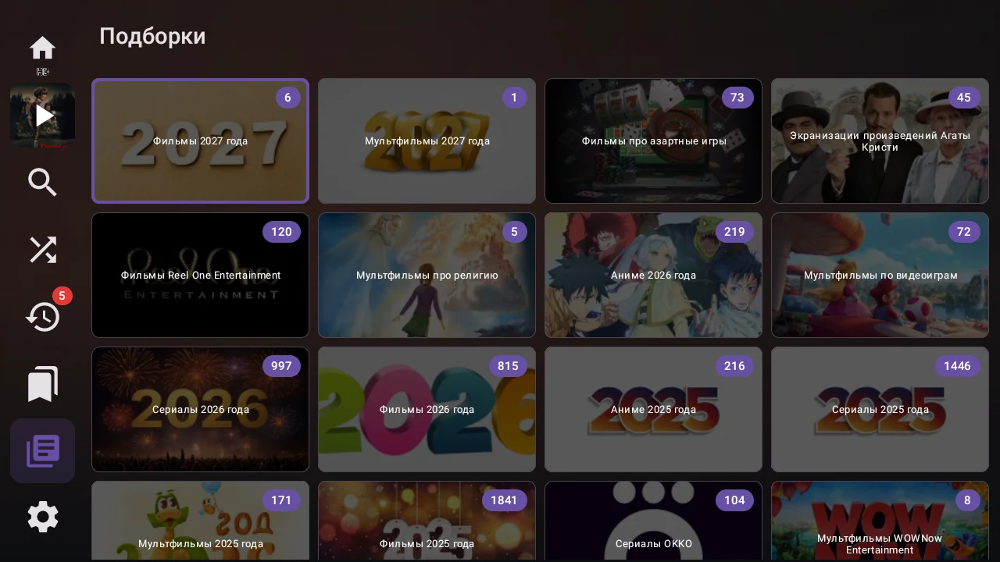
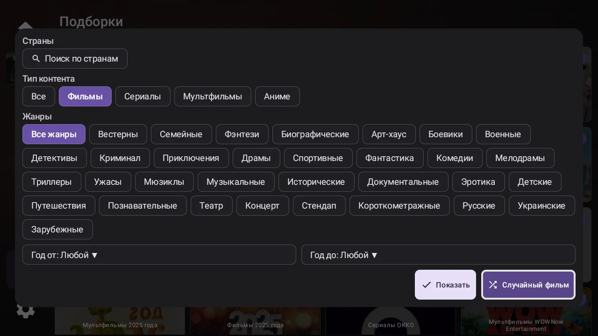

# Rezka TV

**Агрегатор каталогов и видеоисточников для Android TV, ТВ-приставок и смартфонов.**

Rezka TV объединяет поиск фильмов, сериалов, мультфильмов и аниме, выбор источника и просмотр в одном приложении. Можно найти тайтл в одном каталоге, выбрать доступный видеоисточник, озвучку и качество, а затем продолжить просмотр с сохранённого места.

**Несколько каталогов · Выбор источников · Управление пультом · Офлайн-просмотр · TorrServer**

## Скриншоты

Каталог на Android TV и карточка сериала с рейтингами и актёрами:

Ещё скриншоты: поиск, источники, подборки и фильтры

## Каталоги и источники

Каталог с описаниями и источник воспроизведения выбираются отдельно: карточка фильма не привязывает просмотр к одному сервису.

| Назначение | Сервисы |
|---|---|
| Каталоги | HDRezka, Kinovod, Movy |
| Поиск и карточки с метаданными | IMDb, Кинопоиск |
| Видеоисточники | HDRezka, Alloha, Kinovod, Collapse, Veoveo, Turbo, Videoseed, Flix, HDVB, Movy |
| Дополнительное воспроизведение | TorrServer, сохранённые загрузки, YouTube-ссылки и трейлеры |

Набор доступных источников зависит от конкретного тайтла. Видимость каталогов, стартовый каталог, активные видеоисточники и их порядок настраиваются в приложении.

## Возможности

### Поиск и выбор фильма

- Поиск по названию и голосовой ввод на поддерживаемых устройствах.
- Фильтры по типу контента, жанру, стране и диапазону годов — в зависимости от каталога.
- Случайный фильм с учётом выбранных фильтров.
- Описания, рейтинги, актёры, связанные фильмы и рекомендации — при наличии данных.
- Избранное, история и раздел «Продолжить просмотр».
- Учёт прогресса серий между каталогами при совпадении внешних идентификаторов тайтла.

### Просмотр

- Общий выбор источника, озвучки, сезона и серии из карточки и плеера.
- Выбор качества, включая 4K при наличии у источника.
- Встроенные аудиодорожки и субтитры, поиск дополнительных субтитров через OpenSubtitles.
- Озвучка из другого видеоисточника поверх выбранного видео с ручной подгонкой звука.
- Настройка скорости и масштаба изображения, перемотка и продолжение с сохранённой позиции.
- Предпросмотр кадров при перемотке, если источник его предоставляет.
- Запуск во внешнем видеоплеере.
- Воспроизведение через подключённый TorrServer.
- Открытие видео из других приложений через «Открыть с помощью» или «Поделиться».
- Статистика воспроизведения и диагностические логи для разбора проблем.

### Загрузки и данные

- Скачивание поддерживаемого видео для просмотра без интернета.
- Управление загрузками в отдельном разделе.
- Экспорт истории просмотра.
- Очистка временных данных и кэша с сохранением настроек и офлайн-загрузок.

### Интерфейс

- Навигация пультом: D-Pad, OK, Back и долгие нажатия.
- Поддержка сенсорного управления на смартфонах и планшетах.
- Отображение контента сеткой или рядами.
- Компактный и классический стили меню, настройка разделов и каталогов.
- Фоновая подсветка Ambilight.
- Интеграция с каналами Android TV.
- Проверка обновлений и установка новых версий из приложения.

## Требования

- **Android 7.0 и выше** (API 24+).
- Интернет для каталогов и онлайн-просмотра.
- Свободное место для офлайн-загрузок.
- Для TorrServer — доступный сервер, настроенный в приложении.

Поддержка качества, кодеков и отдельных функций воспроизведения зависит от устройства и источника.

## Установка и обновление

1. Скачайте APK из раздела [Releases].
2. Если Android запросит, разрешите установку из выбранного приложения.
3. Установите APK и запустите Rezka TV.
4. Выберите удобный каталог и настройте видеоисточники.

Для обновления установите новую версию поверх существующей. Сохранение данных при обновлении требует совместимой подписи APK. Удаление приложения может привести к потере локальной истории, настроек и загрузок.

## Доступность контента

Rezka TV — неофициальное приложение, использующее сторонние каталоги, метаданные и видеоисточники. Оно не является официальным клиентом перечисленных сервисов.

Доступность фильмов, озвучек, субтитров и качества зависит от источника, региона, сети и условий доступа. Некоторые возможности могут требовать авторизации или Premium-доступа. Наличие карточки в каталоге не гарантирует наличие доступного видео.

Внешние субтитры и озвучка из другого источника могут отличаться по монтажу и таймингу; для звука предусмотрена ручная подгонка. Офлайн-загрузка и запуск во внешнем плеере доступны не для всех потоков.

## Обратная связь

При сообщении о проблеме укажите:

- Версию приложения, модель устройства и версию Android.
- Название фильма или сериала, сезон и серию.
- Каталог, видеоисточник, озвучку и качество.
- Шаги воспроизведения и текст ошибки.
- Скриншот или диагностический лог, если он доступен.

Перед отправкой логов удалите токены, личные данные и приватные ссылки.
